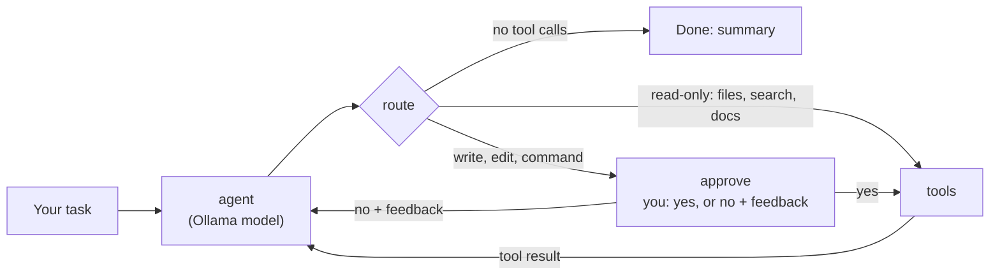

# LocalCoder

A coding agent that runs entirely on your own machine. A local Ollama model explores a repo, looks up library documentation, edits code and runs tests, while LangGraph orchestrates the loop and **every file write or shell command waits for your approval**. No API bill, and no code leaves your laptop.

Built to run on modest hardware: everything here was developed and evaluated on a laptop RTX 3050 with 4 GB of VRAM.

> Portfolio project, not intended for production use.

## What it does

- **Reads before it answers.** Lists and reads files in a sandboxed workspace instead of guessing.
- **Checks the docs before writing code.** Searches configured documentation sources (LangGraph, LangChain, MCP, Python) and reads the relevant pages first.
- **Edits with small, exact changes.** Prefers replacing a unique snippet over rewriting whole files, which small local models handle far more reliably.
- **Verifies its own work.** Runs `pytest` after every change and fixes failures.
- **Asks before acting.** Writes, edits and commands pause for a yes, a no, or written feedback the agent then acts on.
- **Works as an MCP server.** The same tools can be used from Claude Desktop, Claude Code or any MCP client.
- **Measured, not just demoed.** Ships with an eval suite of fixture repos scored by their own tests.

## How it works



A LangGraph `StateGraph` with three nodes. After each model reply, a router sends read-only tool calls straight to execution, sends anything with side effects to an approval node that pauses the graph with `interrupt()`, and ends the run when the model stops calling tools. A rejection doesn't end the run: your feedback goes back to the model as the tool result. State is checkpointed to SQLite, so a session can be resumed later.

### Tools

| Tool | Approval | What it does |
| --- | --- | --- |
| `list_files` | No | List files in the workspace |
| `read_file` | No | Read a file with line numbers |
| `search_code` | No | Plain-text search across the workspace |
| `list_doc_sources` | No | List configured documentation sources |
| `search_docs` | No | Search one source's index for relevant pages |
| `fetch_doc` | No | Read a documentation page in chunks (allowed domains only) |
| `write_file` | **Yes** | Create or overwrite a file |
| `edit_file` | **Yes** | Replace one exact snippet; fails unless it matches exactly once |
| `run_command` | **Yes** | Run an allowlisted command (`pytest`, `python`, `uv`, `ruff`, `git`) with a timeout |

### Safety design

- **Workspace sandbox:** every path is resolved against `workspace/`; `../` escapes are rejected.
- **Command allowlist and timeout:** only five commands, 60 seconds each by default.
- **Approval gate:** nothing changes on disk without a human yes.
- **Docs domain allowlist:** `fetch_doc` only reaches domains listed in `doc_sources.json`, including after redirects, and fetched pages are labeled as reference material, not instructions.
- **Step limit:** a run stops after 25 agent steps so a confused model can't loop forever.

## Quickstart

Requirements: [Ollama](https://ollama.com), [uv](https://docs.astral.sh/uv/), Python 3.11+.

```bash
git clone https://github.com/ProtosaurusRex/LocalCoder.git
cd LocalCoder
ollama pull qwen3:4b
cp .env.example .env        # Windows: copy .env.example .env
uv sync
uv run localcoder
```

Put the code you want to work on in `workspace/`, then give the agent a task:

```text
you> Fix the bug in calc.py and add a pytest test for it.
→ list_files
→ read_file calc.py
→ edit_file calc.py          [approval panel shows the diff]
→ write_file test_calc.py    [approval panel shows the file]
→ run_command pytest -q      [approval panel shows the command]
LocalCoder: Changed `return a - b` to `return a + b`, added test_calc.py. 1 passed.
```

At each approval panel, press Enter or type `y` to approve, `n` to reject, or type feedback (for example *use a docstring*) to reject with instructions. Resume an earlier session with `uv run localcoder --thread <id>`.

## Choosing a model

Tool-calling reliability matters more than raw coding skill, so models were compared on whether they call the right tool, not just any tool. Full write-up: [`docs/model_comparison.md`](docs/model_comparison.md).

| Model | Result on a 4 GB GPU |
| --- | --- |
| `qwen2.5-coder:14b` | Out of GPU memory |
| `qwen2.5-coder:3b` / `7b` | 0% structured tool calls: they write tool calls as JSON text instead of Ollama's tool-call format |
| `llama3.2` (3B) | Fast, but with all tools available it ran the file instead of reading it, then invented an answer |
| **`qwen3:4b`** | **Lists the files, reads the right one, answers correctly. Chosen.** |

The takeaway: a single-tool benchmark flatters small models. With the full toolset, choosing the right tool is the hard part, and a general model that reasons beat code-specialized ones that couldn't emit structured tool calls.

Have a bigger GPU? See [Running on more powerful hardware](#running-on-more-powerful-hardware).

## Running on more powerful hardware

LocalCoder's defaults are tuned for a 4 GB GPU, and that is its main limitation. The context window (how much conversation the model can see at once) is bounded by VRAM. At 8k tokens, a multi-file task plus documentation lookups can overflow it, and Ollama silently drops the oldest messages, including the system prompt and the task. In testing, that is what turned a 5/5 eval run into failures once documentation research was added. A larger GPU allows both a stronger model and a larger context, which removes this failure mode.

Three settings in `.env` control it:

```bash
OLLAMA_MODEL=qwen3:8b
OLLAMA_NUM_CTX=16384
DOCS_MAX_CHARS=6000
```

Starting points by VRAM (approximate; actual fit depends on context size and what else uses the GPU):

| VRAM | `OLLAMA_MODEL` | `OLLAMA_NUM_CTX` | `DOCS_MAX_CHARS` |
| --- | --- | --- | --- |
| 4 GB | `qwen3:4b` (default) | 8192 | 2000 (default) |
| 8 GB | `qwen3:8b` | 16384 | 4000–6000 |
| 12–16 GB | `qwen3:14b` or `gpt-oss:20b` | 32768 | 8000 |
| 24 GB+ | `qwen3-coder:30b` | 32768+ | 8000+ |
| No suitable GPU | Hosted model ([see below](#swapping-in-a-hosted-model)) | n/a | 8000+ |

Before switching models, check two things:

1. **Tool calling.** Not every model emits structured tool calls through Ollama; several code-tuned models write them as plain text, which the agent can't use. Run `uv run python scripts/compare_models.py <your-model> qwen3:4b` and keep a model only if its tool-call rate is 0.9 or higher.
2. **Memory.** If Ollama reports `CUDA error: out of memory`, lower `OLLAMA_NUM_CTX` first, then try a smaller model. `ollama ps` shows how much of the model is on GPU versus CPU; anything below 100% GPU will be noticeably slower.

Then run the eval suite on the new setup and compare pass rates and times against the table in [Evaluation](#evaluation).

## Evaluation

`evals/tasks/` holds small fixture repos, each with a planted bug and a failing test: an off-by-one, an empty-input crash, an import broken across two files, a missing feature described by a test, and a swapped date format. The runner copies each task into a temp folder, auto-approves inside that sandbox, and scores a pass when `pytest` exits 0.

```bash
uv run python evals/run_evals.py qwen3:4b
```

| Setting (`qwen3:4b`) | Pass rate | Avg steps | Total time |
| --- | --- | --- | --- |
| Thinking on (default) | 5/5 | 5.6 | 26.7 min |
| Thinking off | 5/5 | 6.0 | 38.1 min |
| Thinking on + docs research before every change | 3/5 | 6.4 | 70.8 min |

Requiring a documentation lookup before every change cost two tasks: on a 4 GB GPU the doc pages overflowed the 8k context on the multi-file tasks. The research step is now scoped to code that calls library APIs, with smaller doc chunks (see [Running on more powerful hardware](#running-on-more-powerful-hardware)).

Turning off qwen3's reasoning didn't make it faster: it took extra steps on the multi-file tasks. Most time per step is the model re-reading the growing conversation on a small GPU. These five tasks are deliberately easy, so the 100% shows the harness works rather than where the model's ceiling is; harder tasks are the obvious next addition. Reference fixes live in `evals/solutions/` and are never shown to the agent.

## Adding documentation sources

Documentation sources live in [`doc_sources.json`](doc_sources.json). To give the agent another library's docs, add an entry:

```json
{
  "name": "pydantic",
  "description": "Pydantic: data validation and settings",
  "index": "https://docs.pydantic.dev/latest/llms.txt",
  "domains": ["docs.pydantic.dev"]
}
```

- `index` is either an [`llms.txt`](https://llmstxt.org) file (preferred: compact and LLM-friendly) or any HTML page full of links, such as a library reference index.
- `domains` lists every host the agent may fetch from for this source, including redirect targets.
- `description` is what the model reads when choosing a source, so name the library and what it covers.

Included by default: `langgraph`, `langchain`, `langchain-integrations`, `mcp` and `python` (standard library).

## Using it as an MCP server

LocalCoder includes an MCP server exposing the read-only workspace tools, the documentation tools, and `ask_localcoder`, which hands a read-only question to the local agent. Writes are off unless `LOCALCODER_MCP_WRITE=1` is set.

```bash
uv run mcp dev src/localcoder/mcp_server.py      # inspect it
```

Setup for Claude Desktop and Claude Code: [`docs/mcp_setup.md`](docs/mcp_setup.md).

## Swapping in a hosted model

The model is created in one place, `src/localcoder/llm.py`. To run the same agent, tools, approval gate and evals on Claude:

```bash
uv add langchain-anthropic
```

Then in `.env`:

```bash
LLM_PROVIDER=anthropic
ANTHROPIC_API_KEY=your-key
ANTHROPIC_MODEL=claude-sonnet-5-5
```

Running the eval suite on both gives a direct local-vs-hosted comparison.

## Configuration

All settings live in `.env` (see [`.env.example`](.env.example)):

| Variable | Default | Purpose |
| --- | --- | --- |
| `LLM_PROVIDER` | `ollama` | `ollama` or `anthropic` |
| `OLLAMA_MODEL` | `qwen3:4b` | Local model name |
| `OLLAMA_REASONING` | `true` | Qwen3 thinking mode |
| `WORKSPACE_ROOT` | `./workspace` | The only folder the agent can touch |
| `MAX_STEPS` | `25` | Agent step limit per task |
| `COMMAND_TIMEOUT_S` | `60` | Timeout for `run_command` |
| `DOC_SOURCES` | `doc_sources.json` | Documentation sources file |
| `DOCS_MAX_CHARS` | `2000` | Characters per `fetch_doc` chunk |

## Project layout

```text
src/localcoder/
├── config.py        settings from .env
├── llm.py           model factory (Ollama or Anthropic)
├── tools.py         sandboxed file and command tools
├── docs.py          documentation search and fetch tools
├── graph.py         LangGraph state machine and approval gate
├── prompts.py       system prompt
├── cli.py           interactive runner with approval panels
└── mcp_server.py    MCP wrapper
scripts/compare_models.py   tool-calling comparison across models
evals/                      fixture tasks, reference fixes, runner
tests/                      unit tests (uv run pytest)
docs/                       model comparison and MCP setup
```

## Development

```bash
uv run pytest -q
```

Tests cover the workspace sandbox, the approval gate (with a fake model, no Ollama needed) and the documentation tools (offline).

## Tech stack

Python 3.11 · uv · Ollama · LangGraph · LangChain · MCP Python SDK · Rich · pytest

## License

MIT
